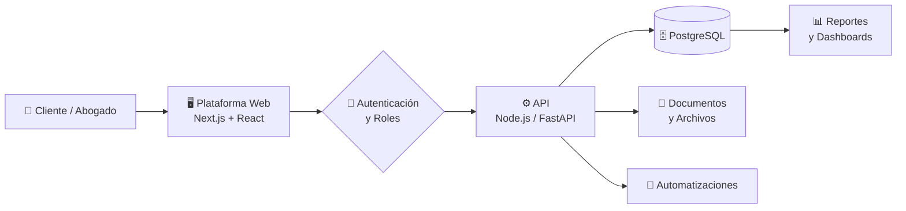

<!-- ======================= HEADER ======================= -->
<p align="center">
  
</p>

<div align="center">

[](https://git.io/typing-svg)


</div>

---

## ⚖️ Quiénes somos

> Somos el **área de tecnología de FH Vélez Abogados**, una firma jurídica en Pereira, Risaralda. Nuestra misión es llevar el ejercicio del derecho al siguiente nivel con **herramientas digitales seguras, escalables y pensadas para abogados**, para que el equipo dedique su tiempo a lo que importa: los clientes y sus casos.

```javascript
const fhVelezTech = {
  firma: "FH Vélez Abogados",
  area: "Departamento de Tecnología",
  ubicacion: "Pereira, Risaralda 🇨🇴",
  mision: "Digitalizar y automatizar la operación jurídica",
  pilares: [
    "Transformación Digital",
    "Automatización de Procesos Legales",
    "Seguridad de la Información",
    "Decisiones basadas en datos"
  ],
  stack: {
    frontend: ["React", "Next.js", "TypeScript", "Tailwind CSS", "Shadcn UI"],
    backend: ["Node.js", "FastAPI", "Python"],
    datos: ["PostgreSQL", "Supabase", "Prisma"],
    devops: ["Git", "GitHub Actions"]
  },
  lema: "Tecnología al servicio de la justicia."
};
```

---

## 🧩 Qué hacemos

<table>
<tr>
<td width="50%" valign="top">

### 🗂️ Gestión digital de casos
Centralizamos expedientes, documentos y seguimiento de procesos en plataformas internas, con acceso por roles y trazabilidad.

</td>
<td width="50%" valign="top">

### ⚙️ Automatización
Eliminamos tareas repetitivas: generación de documentos, recordatorios de términos, flujos de aprobación y reportes.

</td>
</tr>
<tr>
<td width="50%" valign="top">

### 🔐 Seguridad y privacidad
La información de nuestros clientes es sagrada. Diseñamos con seguridad desde el inicio y en línea con la **Ley 1581 de 2012** (Habeas Data).

</td>
<td width="50%" valign="top">

### 📊 Inteligencia de datos
Tableros e indicadores que ayudan a la firma a tomar mejores decisiones operativas y estratégicas.

</td>
</tr>
</table>

---

## 🏗️ Cómo construimos



---

## 🛠️ Stack Tecnológico

<div align="center">

**Frontend**


**Backend & Datos**


**DevOps & Herramientas**


</div>

---

## 🗺️ Roadmap 2026

- [x] 🚀 Creación del Departamento de Tecnología
- [x] 🧭 Diagnóstico de procesos internos de la firma
- [ ] 🗂️ Plataforma interna de gestión de casos
- [ ] 📄 Generador automático de documentos jurídicos
- [ ] ⏰ Alertas de términos y vencimientos procesales
- [ ] 👥 Portal de clientes para consulta del estado de sus procesos
- [ ] 📊 Dashboard de indicadores de la firma

---

## 🛡️ Nuestros principios

| | Principio | Qué significa |
|---|---|---|
| 🔐 | **Seguridad primero** | Cifrado, control de acceso por roles y mínimos privilegios |
| 🤝 | **Confidencialidad** | El secreto profesional también aplica al código |
| ⚡ | **Eficiencia** | Si se repite más de tres veces, se automatiza |
| 📈 | **Escalabilidad** | Soluciones que crecen con la firma |
| 🧪 | **Calidad** | Código revisado, probado y documentado |

---

## 👨‍💻 Equipo

<div align="center">

|  |
|:---:|
| **Nicolás Castaño Delgado** |
| IT Director / Software Engineer |
| [](https://github.com/nicoj3000) [](https://www.linkedin.com/in/nicolas-delgado-6b22372b7/) |

</div>

---

## 📈 Actividad

<div align="center">
  
</div>

<p align="center">
  <!-- Se genera automáticamente con .github/workflows/snake.yml -->
  <picture>
    <source media="(prefers-color-scheme: dark)" srcset="https://raw.githubusercontent.com/Nicoj3000-hqw/Nicoj3000-hqw/output/github-snake-dark.svg" />
    
  </picture>
</p>

---

## 📫 Contacto

<p align="center">
  <a href="mailto:CORREO@EMPRESA.COM">
    
  </a>
  <a href="https://TU-SITIO-WEB.COM" target="_blank">
    
  </a>
  <a href="https://github.com/Nicoj3000-hqw" target="_blank">
    
  </a>
</p>

<p align="center"><i>⚖️ "Tecnología al servicio de la justicia."</i></p>

<!-- ======================= FOOTER ======================= -->
<p align="center">
  
</p>
